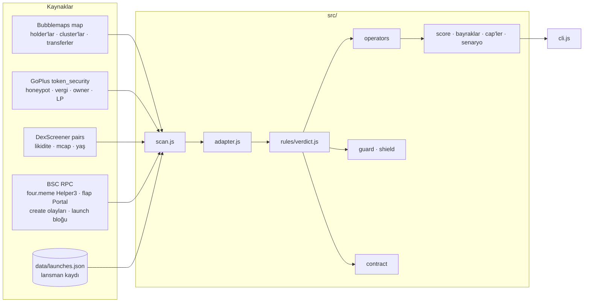

# Mimari

QuantumOrb BSC, üç hazır HTTP kaynağı ve iki launchpad kontratının üstünde çalışan saf bir kural motorudur.
Kendi indeksleyicisi ve veritabanı yoktur; tek yerel durum, lansman kaydı denen bir JSON dosyasıdır. Bir
tarama üç HTTP çağrısı, birkaç `eth_call` ve bir fonksiyon çağrısıdır.

## Katmanlar

| Katman | Dosya | Sorumluluk |
|---|---|---|
| HTTP istemcileri | `src/sources/bubblemaps.js` · `goplus.js` · `dexscreener.js` | Tek bir endpoint'i çağırır, ham cevabı döndürür. Yorum yapmaz. |
| Zincir | `src/sources/rpc.js` · `abi.js` | JSON-RPC ve bağımlılıksız ABI (keccak256, seçici, çözme). Seçiciler imzadan hesaplanır. |
| Launchpad'ler | `src/sources/fourmeme.js` · `flap.js` · `launchpad.js` | Her platformun adresleri, çağrıları ve çözücüleri; `launchpad.js` ikisini tek `Launch` nesnesinde birleştirir: durum, sanal rezerv, creator, yaratılış, launch bloğu, creator geçmişi. |
| Lansman kaydı | `src/record.js` | İki launchpad'in create olaylarından yerel kayıt; `cli.js index` doldurur. |
| Eşleme | `src/adapter.js` | Ham cevapları `ScanInput`'a çevirir. Hangi adres holder sayılır, hangi transfer alımdır, hangi parça ölçülemez: tüm bu kararlar buradadır. [`kaynaklar.md`](kaynaklar.md) |
| Kural motoru | `src/rules/*.js` | Saf fonksiyonlar. Ağ yok, zaman yok, rastgelelik yok. Aynı girdi her zaman aynı verdict. [`skor.md`](skor.md) |
| Eşikler | `src/config/rules.js` | Her sayı tek yerde. Kodda sihirli sayı yok. |
| Orkestrasyon | `src/scan.js` | HTTP kaynaklarını paralel okur, sonra launchpad'i ve kaydı; birinin düşmesi diğerlerini durdurmaz. Bubblemaps olmadan tarama yapılamaz. |
| Komut satırı | `src/cli.js` | Adres ya da hazır girdi dosyası alır, raporu basar; `index` alt komutu kaydı doldurur. |

## Bir taramada ne olur

1. **Üç HTTP kaynağı paralel okunur.** Her biri ayrı ayrı başarısız olabilir; sonuç `sources` alanında görünür.
2. **Launchpad sorulur.** four.meme `getTokenInfo` ve flap `getTokenV8Safe` paralel çağrılır; tanıyan platform
   kazanır. Curve'deyse sanal token rezervi çıkar (flap kapalı formül, four.meme bir `tryBuy` kotası).
3. **Yaratılış bulunur.** Önce lansman kaydı; yoksa four.meme için DexScreener'ın pair zamanından blok bulunup
   `TokenCreate` okunur. Creator `eth_getCode` ile cüzdan mı kontrat mı diye ayrılır. Launch bloğundaki token
   `Transfer`'leri ilk alıcıları ve dev'in aldığını verir.
4. **Creator geçmişi** kayıttan sayılır; son 20 lansmanın durumu zincirden okunup kaçının mezun olduğu bulunur.
5. **Holder'lar seçilir.** Bubblemaps'in top listesinden havuz, kontrat, borsa ve burn adresleri çıkarılır.
   Kalan ilk 20 cüzdan, payları float'a göre yeniden hesaplanarak holder olur.
6. **Linkler kurulur.** Bubblemaps cluster'ları ve iki top holder arasındaki doğrudan transferler kanıtlı
   linktir. Sıradan bir cüzdandan gelen token "received, not bought" sayılır.
7. **Fresh cüzdanlar bulunur.** Cüzdanın ilk aktivitesi token'ın yaratılışından önce değilse fresh'tir.
   Yaratılış bilinmiyorsa bu parça ölçülemez.
8. **Operatörler ve skor** hesaplanır: kural motoru. Kontrat kapıları (honeypot, yüksek vergi), Guard ve
   (launchpad token'ında) Shield her durumda eklenir.
9. **Rapor** basılır: skor, parçalar, bayraklar, operatörler, launchpad kartı, Guard, Shield, kontrat kartı,
   piyasa ve kaynak durumu.

## Ne yok

- **Radar ve Telegram botu.** Tarama isteğe bağlıdır; lansman akışı canlı dinlenmez. Lansman kaydı Radar'ın
  tohumudur: Radar yazıldığında create olaylarını canlı dinleyip aynı dosyayı besleyecek.
- **Tam creator geçmişi.** Yalnızca kaydın gördüğü lansmanlar sayılır. Kayıt seri lansmancıyı gösterebilir,
  kimseyi temize çıkaramaz; Guard'ın ilk kontrolü aleyhe kanıt yoksa "okunmadı" kalır.
- **Sniper zamanlaması.** Giriş saniyesi okunmaz; ilgili parça ölçülemez ve kalan ağırlıklar 100'e ölçeklenir.
  Launch bloğu alıcıları (`bundle`) okunur ve satış senaryosuna girer.
- **Eski token'ların yaratılışı.** Public RPC yaklaşık iki günlük log verir; daha eski bir token kayıtta
  yoksa creator ve yaş okunmaz. Arşiv RPC bunu çözer.
- **Depolama ve önbellek.** Her çağrı kaynaklara gider. Ücretli Bubblemaps çağrısını azaltmak için bir
  önbellek eklenebilir.

Bunların her biri için [`kararlar.md`](kararlar.md) içinde bir madde var.
