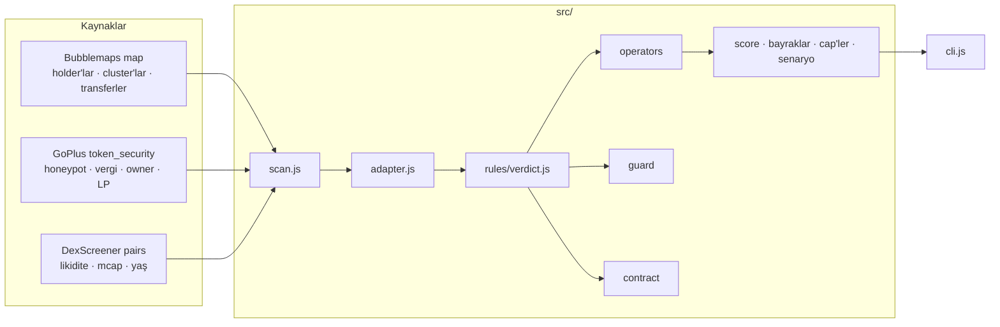

# Mimari

QuantumOrb BSC, üç hazır kaynağın üstünde çalışan saf bir kural motorudur. Kendi indeksleyicisi, veritabanı
ve zincir okuyucusu yoktur. Bir tarama üç HTTP çağrısı ve bir fonksiyon çağrısıdır.

## Katmanlar

| Katman | Dosya | Sorumluluk |
|---|---|---|
| Kaynak istemcileri | `src/sources/*.js` | Tek bir endpoint'i çağırır, ham cevabı döndürür. Yorum yapmaz. |
| Eşleme | `src/adapter.js` | Ham cevapları `ScanInput`'a çevirir. Hangi adres holder sayılır, hangi transfer alımdır, hangi parça ölçülemez: tüm bu kararlar buradadır. [`kaynaklar.md`](kaynaklar.md) |
| Kural motoru | `src/rules/*.js` | Saf fonksiyonlar. Ağ yok, zaman yok, rastgelelik yok. Aynı girdi her zaman aynı verdict. [`skor.md`](skor.md) |
| Eşikler | `src/config/rules.js` | Her sayı tek yerde. Kodda sihirli sayı yok. |
| Orkestrasyon | `src/scan.js` | Üç kaynağı paralel okur, birinin düşmesi diğerlerini durdurmaz. Bubblemaps olmadan tarama yapılamaz. |
| Komut satırı | `src/cli.js` | Adres ya da hazır girdi dosyası alır, raporu basar. |

## Bir taramada ne olur

1. **Üç kaynak paralel okunur.** Her biri ayrı ayrı başarısız olabilir; sonuç `sources` alanında görünür.
2. **Holder'lar seçilir.** Bubblemaps'in top listesinden havuz, kontrat, borsa ve burn adresleri çıkarılır.
   Kalan ilk 20 cüzdan, payları float'a göre yeniden hesaplanarak holder olur.
3. **Linkler kurulur.** Bubblemaps cluster'ları ve iki top holder arasındaki doğrudan transferler kanıtlı
   linktir. Sıradan bir cüzdandan gelen token "received, not bought" sayılır.
4. **Fresh cüzdanlar bulunur.** Cüzdanın ilk aktivitesi token'ın ilk pair'inden önce değilse fresh'tir.
   Token yaşı bilinmiyorsa bu parça ölçülemez.
5. **Operatörler ve skor** hesaplanır: kural motoru. Kontrat kapıları (honeypot, yüksek vergi) ve Guard
   her durumda eklenir.
6. **Rapor** basılır: skor, parçalar, bayraklar, operatörler, Guard, kontrat kartı, piyasa ve kaynak durumu.

## Ne yok

- **Radar ve Telegram botu.** Tarama isteğe bağlıdır; lansman akışı dinlenmez. `rules/shield.js` Radar için
  hazır durur ama onu besleyen four.meme olay okuyucusu yazılmadı.
- **Creator geçmişi.** Üç kaynaktan hiçbiri "bu cüzdan kaç token çıkardı" sorusunu yanıtlamaz. Guard'ın
  ilk kontrolü "okunmadı" kalır ve rapor GUARD · PARTIAL der.
- **Sniper zamanlaması.** Giriş saniyesi bu kaynaklarda yoktur; ilgili parça ölçülemez ve kalan ağırlıklar
  100'e ölçeklenir.
- **Depolama ve önbellek.** Her çağrı kaynaklara gider. Ücretli Bubblemaps çağrısını azaltmak için bir
  önbellek eklenebilir.

Bunların her biri için [`kararlar.md`](kararlar.md) içinde bir madde var.
